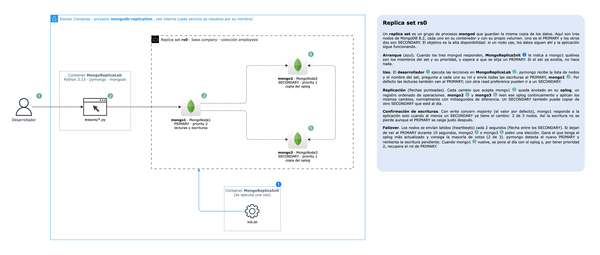

# MongoDB Replica Set

Proyecto para entender cómo funciona un **replica set de MongoDB**: tres nodos con la misma copia de los datos,
elección automática del PRIMARY y una aplicación en Python (`pymongo`) que escribe, lee, consulta y agrega datos
sobre una sola colección (`employees`).



> Diagrama editable: [`docs/architecture.drawio`](docs/architecture.drawio).

## 1. Conceptos de MongoDB

### ¿Qué es MongoDB?

MongoDB es una base de datos **NoSQL orientada a documentos**. En lugar de tablas con filas y columnas, guarda
**documentos** parecidos a JSON, que pueden tener subdocumentos y arrays. Dos documentos de la misma colección
pueden tener campos distintos (esquema flexible).

| Concepto | Qué es | En este proyecto |
| --- | --- | --- |
| **Clúster** | Conjunto de procesos MongoDB que trabajan como una sola base de datos. | El replica set `rs0` |
| **Nodo** | Un proceso `mongod` que forma parte del clúster, normalmente en su propio servidor. Aquí, cada nodo es un contenedor. | `mongo1`, `mongo2`, `mongo3` |
| **Replica set** | Grupo de nodos con los mismos datos: un **PRIMARY** y varios **SECONDARY**. | `rs0` |
| **Database** | Contenedor lógico de colecciones. Un nodo puede tener muchas bases. | `company` |
| **Collection** | Grupo de documentos, equivalente a una tabla. | `employees` |
| **Document** | Un registro en formato BSON (JSON binario), de hasta 16 MB. Todo documento tiene un `_id` único. | Un empleado |
| **Field** | Un par nombre-valor dentro del documento. | `name`, `salary`, `skills` |
| **Índice** | Estructura ordenada (B-tree) que evita recorrer toda la colección en una búsqueda. | `email` (único), `department` |

Un documento de este proyecto:

```javascript
{
  _id: ObjectId("6ac9cfd20f0df60f9afe05ec"),   // identificador único, generado por el driver
  employee_id: "E0001",
  name: "Ana Gómez",
  email: "ana.gomez.1@company.com",
  department: "Ingeniería",
  title: "Tech Lead",
  city: "Bogotá",
  salary: 9500000,
  skills: ["python", "mongodb", "aws"],          // array
  hired_at: ISODate("2023-03-15T00:00:00Z"),     // fecha (UTC)
  active: true
}
```

### Programas de MongoDB

| Programa | Qué hace |
| --- | --- |
| **`mongod`** | El **servidor de base de datos**: guarda los datos en disco, ejecuta las consultas, mantiene los índices y replica. Cada nodo del replica set es un `mongod`. |
| **`mongosh`** | El **shell interactivo** de MongoDB, en JavaScript. Sirve para consultar y administrar: `db.employees.find()`, `rs.status()`. |
| **`mongos`** | El **router** que usan los clústeres fragmentados (*sharded*) para repartir los datos entre varios grupos de servidores. Un replica set no lo necesita, así que este proyecto no lo usa. |
| **Driver (`pymongo`)** | Biblioteca con la que una aplicación habla con MongoDB. Descubre los nodos, mantiene un pool de conexiones y reintenta si cambia el PRIMARY. |
| `mongodump` / `mongorestore` | Respaldo y restauración. |
| `mongostat` / `mongotop` | Monitoreo en vivo. |

### Cómo funciona la base de datos por dentro

- **WiredTiger** es el motor de almacenamiento:
  - Bloquea a nivel de documento, así que muchas escrituras pueden ocurrir en paralelo.
  - Mantiene una caché en memoria con los datos más usados.
  - Comprime los datos en disco.
- **Journal**: cada escritura se anota primero en un registro (*journal*) y luego, cada ~60 s, se consolida en
  los archivos de datos (*checkpoint*). Si el proceso se cae, al reiniciar reproduce el journal y no pierde nada.
- **Índices**: sin índice, una consulta revisa todos los documentos (`COLLSCAN`). Con índice, revisa solo las
  entradas que coinciden (`IXSCAN`). `explain()` muestra qué plan eligió MongoDB.

## 2. Replicación

```text
                  escrituras
  aplicación ─────────────────► PRIMARY (mongo1)
                                   │  oplog
                         ┌─────────┴─────────┐
                         ▼                   ▼
                  SECONDARY (mongo2)   SECONDARY (mongo3)
```

- **PRIMARY**: el único nodo que acepta escrituras. Cada cambio queda registrado en su **oplog**
  (`local.oplog.rs`), una lista ordenada de operaciones.
- **SECONDARY**: copian el oplog del PRIMARY (o de otro SECONDARY al día) y aplican los mismos cambios, en el mismo
  orden. Por eso tienen los mismos datos, con milisegundos de diferencia.
- **Latidos y elecciones**:
  - Los nodos se envían un *heartbeat* cada 2 s.
  - Si nadie ve al PRIMARY durante 10 s, un SECONDARY pide una **elección**.
  - Gana el nodo con el oplog más actualizado que consiga la **mayoría** de votos: con 3 nodos, 2 votos. Por eso
    se usan números impares de nodos.
- **Prioridad**: `mongo1` tiene prioridad 2 y los demás 1, así que `mongo1` es el PRIMARY preferido y recupera el
  rol cuando vuelve.
- **El driver se adapta solo**: `pymongo` recibe la lista de nodos y el nombre del set. Pregunta a cada nodo su rol
  (`hello`) y, si cambia el PRIMARY, lo detecta y reintenta la escritura pendiente (*retryable writes*).

Tres opciones controlan la consistencia en cada operación:

| Opción | Qué decide | Valores |
| --- | --- | --- |
| **Write concern** | Cuántos nodos deben confirmar una escritura antes de responder | `w=1` (solo el PRIMARY), `w="majority"` (por defecto: 2 de 3, no se pierde aunque caiga el PRIMARY), `w=3` |
| **Read preference** | A qué nodo va una lectura | `primary` (por defecto), `secondary`, `secondaryPreferred`, `nearest` |
| **Read concern** | Qué tan confirmados deben estar los datos leídos | `local` (lo último del nodo), `majority` (ya replicado a la mayoría; nunca se revierte) |

## 3. Cómo está armado el proyecto

| Contenedor | Imagen / proceso | Puerto en el host | Rol |
| --- | --- | --- | --- |
| `MongoNode1` (`mongo1`) | `mongo:8.2.12` · `mongod --replSet rs0` | 27021 | Nodo con prioridad 2 (PRIMARY preferido) |
| `MongoNode2` (`mongo2`) | `mongo:8.2.12` · `mongod --replSet rs0` | 27022 | Nodo SECONDARY |
| `MongoNode3` (`mongo3`) | `mongo:8.2.12` · `mongod --replSet rs0` | 27023 | Nodo SECONDARY |
| `MongoReplicaInit` | `mongo:8.2.12` · `init.sh` | — | Se ejecuta una vez: `rs.initiate()` con los 3 miembros y espera un PRIMARY |
| `MongoReplicaLab` | Python 3.13 · pymongo · mongosh | — | Donde se ejecutan las lecciones |

**Arranque:**

1. Se inician los tres `mongod`.
2. Cuando todos responden, `MongoReplicaInit` crea el replica set.
3. `MongoReplicaLab` espera a que haya PRIMARY.

Cada nodo guarda sus datos en un volumen propio, así que sobreviven a los reinicios.

La aplicación se conecta con: `mongodb://mongo1:27017,mongo2:27017,mongo3:27017/?replicaSet=rs0`.

```text
.devcontainer.json          # Dev Container de VS Code
.docker/
  Dockerfile                # img-base (Python + mongosh) -> img-lab
  docker-compose.yml        # Contenedor MongoReplicaLab
  replica-set.yml           # Los 3 nodos + el job de inicialización
  replica-set/init.sh       # rs.initiate()
  entrypoint.sh             # Instala requirements y espera el PRIMARY
.envs/mongo.env             # MONGO_URI y MONGO_DB
docs/architecture.drawio    # Diagrama
src/lab/                    # Cliente de MongoDB y funciones para imprimir
lessons/                    # Lecciones 00-07
```

## 4. Puesta en marcha

**Con VS Code**: `Dev Containers: Reopen in Container`.

**Con la terminal**:

```bash
cd .docker
docker compose -f docker-compose.yml -f replica-set.yml up -d --build
docker exec MongoReplicaLab .docker/entrypoint.sh        # solo la primera vez
docker exec -it MongoReplicaLab bash                     # entrar al contenedor
```

Dentro del contenedor (`/app`):

```bash
python lessons/00_seed.py      # siempre primero
python lessons/01_crud.py      # y así con las demás, en orden
mongosh "$MONGO_URI"           # shell interactivo
```

Apagar (`stop`) o borrar todo, incluidos los datos (`down -v`):

```bash
cd .docker
docker compose -f docker-compose.yml -f replica-set.yml down -v
```

### Abrir los nodos en MongoDB Compass

Cada nodo está publicado en un puerto distinto de tu equipo. En Compass crea una conexión por nodo
(**New Connection** → pega la URI → **Save & Connect**):

| Nodo | URI |
| --- | --- |
| mongo1 (PRIMARY) | `mongodb://localhost:27021/?directConnection=true` |
| mongo2 (SECONDARY) | `mongodb://localhost:27022/?directConnection=true` |
| mongo3 (SECONDARY) | `mongodb://localhost:27023/?directConnection=true` |

`directConnection=true` es necesario. Sin él, Compass le pregunta al nodo quiénes son los miembros del set,
recibe los nombres internos de Docker (`mongo1:27017`...), que tu equipo no conoce, y la conexión falla.

Qué puedes comprobar:

- Los tres nodos muestran la base `company` con los mismos documentos en `employees`.
- **Solo el PRIMARY acepta escrituras**: si insertas o editas en `mongo2` o `mongo3`, Compass muestra el error
  `not primary`.
- **La replicación es inmediata**: edita un empleado en `mongo1` y refresca `mongo2`; el cambio ya está ahí.
- **Failover**: con `docker stop MongoNode1`, la conexión a 27021 se cae y, tras unos 10 s, `mongo2` o `mongo3`
  pasa a PRIMARY y empieza a aceptar escrituras. Compruébalo con `rs.status()` en la pestaña **MONGOSH** de
  Compass. Para restaurarlo: `docker start MongoNode1`.

## 5. Lecciones

| Lección | Qué hace | Qué observar |
| --- | --- | --- |
| `00_seed.py` | Crea la base `company`, inserta 1.000 empleados con `insert_many` y crea los índices. | Las escrituras van al PRIMARY y los SECONDARY ya tienen la copia. |
| `01_crud.py` | **Create**: `insert_one`, `insert_many`. **Read**: `find_one`, `find` con proyección, orden y límite. **Update**: `$set`, `$inc`, `$push`, `$addToSet`, `update_many`, upsert, `find_one_and_update`. **Delete**: `delete_one`, `delete_many`. | El índice único rechaza un email repetido (`DuplicateKeyError`). |
| `02_queries.py` | Operadores de comparación (`$gte`, `$in`), lógicos (`$or`), de arrays (`$all`, `$size`), `$regex`, fechas, `distinct`, paginación y la misma consulta con y sin índice (`explain`). | Sin índice: `COLLSCAN` revisa 1.000 documentos. Con índice: `IXSCAN` revisa solo los 23 que coinciden. |
| `03_aggregations.py` | Pipelines: salario por departamento (`$group`), contrataciones por año, skills más comunes (`$unwind`), rangos salariales (`$bucket`) y un reporte guardado con `$merge`. | Cada etapa transforma la salida de la anterior. |
| `04_replica_set.py` | Muestra el rol, estado, retraso y prioridad de cada nodo; escribe en el PRIMARY y lee el mismo documento **directamente en cada nodo**; muestra el oplog. | Los tres nodos devuelven el mismo dato; el oplog registra cada insert, update y delete. |
| `05_consistency.py` | Mide la latencia con `w=1`, `w="majority"` y `w=3`; provoca un error con `w=4`; envía lecturas con cada *read preference*; compara *read concern*; lee sus propias escrituras desde un SECONDARY (consistencia causal). | `secondary` solo usa mongo2 y mongo3; `nearest` usa los tres. |
| `06_failover.py` | Un hilo escribe sin parar mientras el PRIMARY renuncia (`replSetStepDown`). Imprime cada segundo quién es el PRIMARY y cuántas escrituras funcionaron. | El PRIMARY cambia de mongo1 a mongo2 sin escrituras fallidas. En ~20 s mongo1 lo recupera. |
| `07_change_streams.py` | Escucha en tiempo real los cambios de `employees`; se detiene a la mitad y **reanuda** con el *resume token*. | No se pierde ningún evento al reanudar. |

Para volver al estado inicial: `python lessons/00_seed.py`.

## 6. Experimentos

Desde el host:

```bash
# Apagar el PRIMARY de golpe: tras ~10 s otro nodo es elegido
docker stop MongoNode1
docker exec MongoReplicaLab bash -c 'mongosh "$MONGO_URI" --quiet --eval "rs.status().members.map(m => m.name + \" \" + m.stateStr)"'
docker start MongoNode1      # vuelve como SECONDARY, se pone al día y recupera el PRIMARY

# Apagar 2 de 3 nodos: sin mayoría no hay PRIMARY -> no se puede escribir, pero sí leer de un SECONDARY
docker stop MongoNode2 MongoNode3
docker start MongoNode2 MongoNode3
```

Comandos útiles en `mongosh "$MONGO_URI"`:

```javascript
rs.status()                          // estado de cada nodo
rs.conf()                            // miembros, prioridades y votos
rs.printSecondaryReplicationInfo()   // retraso de cada SECONDARY
rs.stepDown(30)                      // obligar al PRIMARY a renunciar
db.getSiblingDB("local").oplog.rs.find().sort({ $natural: -1 }).limit(5)
use company
db.employees.find({ department: "Ventas" }).limit(3)
db.employees.find({ city: "Cali" }).explain("executionStats")
```

## Notas

- **Sin autenticación**: el proyecto es solo para aprendizaje local; los nodos se publican en `localhost` (27021-27023)
  únicamente para abrirlos con Compass. En producción se usan autenticación entre nodos (`keyFile` o x.509),
  usuarios con roles y TLS.
- Cada `mongod` limita su caché a 256 MB para no consumir demasiada memoria.
